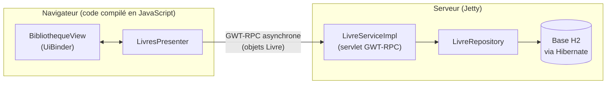

# 📚 Bibliothèque - Application GWT de gestion de catalogue

Application web de gestion d'un catalogue de livres (ajout, consultation, modification, suppression), développée avec **GWT 2.13** côté client et **Java 17 / Hibernate** côté serveur.

Ce projet reproduit l'architecture typique des applications GWT d'entreprise : séparation **client / shared / server**, pattern **MVP**, communication **GWT-RPC**, persistance **JPA/Hibernate** et **tests automatisés** à chaque niveau.


---

## ✨ Fonctionnalités

- Affichage du catalogue dans un tableau (`CellTable`)
- Ajout d'un livre via une boîte de dialogue
- Modification d'un livre (formulaire prérempli)
- Suppression avec demande de confirmation
- Validation des saisies **côté client** (retour immédiat) **et côté serveur** (sécurité), avec le **même code Java**
- Persistance en base de données (les données survivent au redémarrage)


---

## 🛠️ Stack technique

| Couche | Technologies |
|---|---|
| Front-end | GWT 2.13, UiBinder, CellTable |
| Communication | GWT-RPC (asynchrone) |
| Back-end | Java 17, Servlets Jakarta, Jetty 12 |
| Persistance | JPA / Hibernate 6, base H2 |
| Tests | JUnit 5, Mockito, tests d'intégration Hibernate sur H2 en mémoire |
| Build | Maven (projet multi-modules) |

---

## 🏗️ Architecture



### Les trois modules Maven

| Module | Rôle | Contenu principal |
|---|---|---|
| `bibliotheque-client` | Code exécuté dans le navigateur (compilé en JavaScript par GWT) | `BibliothequeView`, `LivresPresenter`, `LivreFormDialog` |
| `bibliotheque-shared` | Code commun au client et au serveur | `Livre` (DTO), `LivreValidator`, interfaces `LivreService` / `LivreServiceAsync` |
| `bibliotheque-server` | Code exécuté sur le serveur | `LivreServiceImpl`, `LivreRepository`, `LivreEntity`, `persistence.xml` |

### Le pattern MVP côté client

- **View** (`BibliothequeView` + `.ui.xml`) : uniquement de l'affichage. Elle transmet les actions de l'utilisateur au presenter.
- **Presenter** (`LivresPresenter`) : contient la logique de l'écran (chargement, validation, appels au serveur). Il ne connaît la vue qu'à travers l'interface `Display`.
- **Model** (`Livre`) : les données échangées.

Comme le presenter dépend uniquement d'**interfaces** (`Display`, `LivreServiceAsync`), il est testable avec JUnit et Mockito, **sans navigateur ni serveur**.

---

## 🚀 Lancer le projet

### Prérequis

- **Java 17** (JDK)
- **Maven 3.9+**

### Démarrage

Cloner le projet :

```bash
git clone https://github.com/VOTRE-PSEUDO/bibliotheque-gwt.git
cd bibliotheque-gwt
```

Lancer les deux processus de développement, **dans deux terminaux séparés** :

```bash
# Terminal 1 : serveur de code GWT (recompile le code client à chaque rafraîchissement)
mvn gwt:codeserver -pl bibliotheque-client -am
```

```bash
# Terminal 2 : serveur d'application Jetty (servlets RPC + base de données)
mvn jetty:run -pl bibliotheque-server -am -Denv=dev
```

Puis ouvrir **http://localhost:8080/** dans le navigateur.

La base H2 est créée automatiquement dans `~/bibliotheque-gwt/` et initialisée avec quelques livres au premier lancement. Pour repartir de zéro, il suffit de supprimer ce dossier.

---

## ✅ Tests

Lancer tous les tests :

```bash
mvn test
```

| Type | Classe | Ce qui est vérifié |
|---|---|---|
| Tests unitaires (client) | `LivresPresenterTest` | Logique du presenter : chargement, ajout, modification, suppression, confirmation, gestion des erreurs serveur. Vue et service **mockés** avec Mockito ; les callbacks asynchrones sont capturés avec `ArgumentCaptor` pour simuler les réponses du serveur. |
| Tests d'intégration (serveur) | `LivreRepositoryTest` | Vraies requêtes Hibernate sur une base **H2 en mémoire**, recréée vide pour chaque test (la base de l'application n'est jamais touchée). |
| Tests end-to-end | `BibliothequeE2ETest` (module `bibliotheque-e2e`) | Parcours utilisateur réel dans Chromium piloté par **Playwright** : ajout, modification, suppression d'un livre et validation du formulaire. |

Les tests end-to-end nécessitent que l'application soit lancée (voir « Lancer le projet »), puis :

```bash
mvn -f bibliotheque-e2e/pom.xml test
# ou, pour voir le navigateur travailler :
mvn -f bibliotheque-e2e/pom.xml test -Dvisible=true
```

---

## 💡 Choix techniques

**Séparation Entity / DTO.**
`LivreEntity` (serveur, annotée JPA) et `Livre` (shared, envoyé au client) sont deux classes distinctes. `Livre` est compilé en JavaScript par GWT, qui ne connaît pas les annotations JPA, et GWT-RPC ne sait pas sérialiser les proxies et collections propres à Hibernate. La conversion se fait dans `LivreEntity.depuisDto()` / `versDto()`.

**Validation partagée.**
`LivreValidator` est placé dans le module `shared` : le même code valide les saisies dans le navigateur (retour immédiat, sans appel réseau) et sur le serveur (on ne fait jamais confiance au client).

**Transactions.**
Toutes les écritures passent par une méthode `enTransaction()` dans `LivreRepository` : commit si tout se passe bien, rollback en cas d'erreur. La modification s'appuie sur le *dirty checking* d'Hibernate (pas d'appel explicite à `update`).

**Compatibilité GWT-RPC.**
Les listes renvoyées au client sont des `ArrayList` explicites : les listes immuables de Java 17 (`stream().toList()`) ne sont pas sérialisables par GWT-RPC. Un test le vérifie.

**Configuration des tests.**
Le packaging Maven `gwt-app` ne lance par défaut que `gwt:test`. Le plugin Surefire est donc configuré explicitement dans le module client pour exécuter les tests JUnit 5.

---

## 🔭 Pistes d'amélioration

- Navigation entre écrans avec Activities & Places (liste / détail, historique du navigateur)
- Pagination et tri du tableau
- Pool de connexions (HikariCP) et base PostgreSQL pour un usage en production
- Intégration continue (GitHub Actions) lançant les tests à chaque push

---

## 👤 Auteur

**Toky Andrianjafy** - Développeur Full Stack

- LinkedIn : [linkedin.com/in/toky-andrianjafy](https://linkedin.com/in/toky-andrianjafy)
- Portfolio : [toky-andrianjafy.vercel.app](https://toky-andrianjafy.vercel.app)